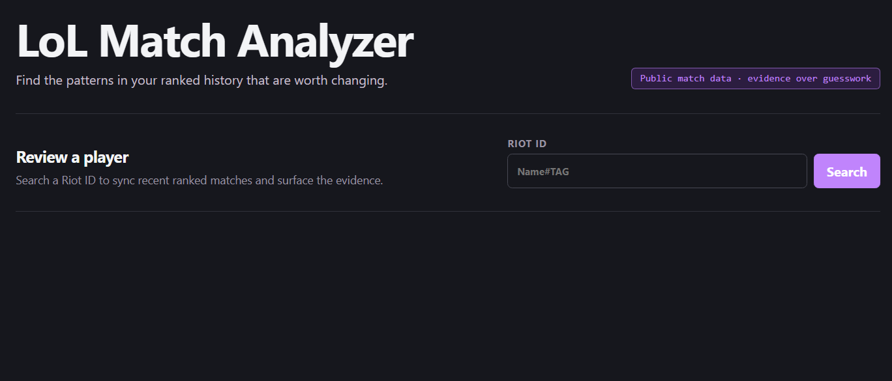
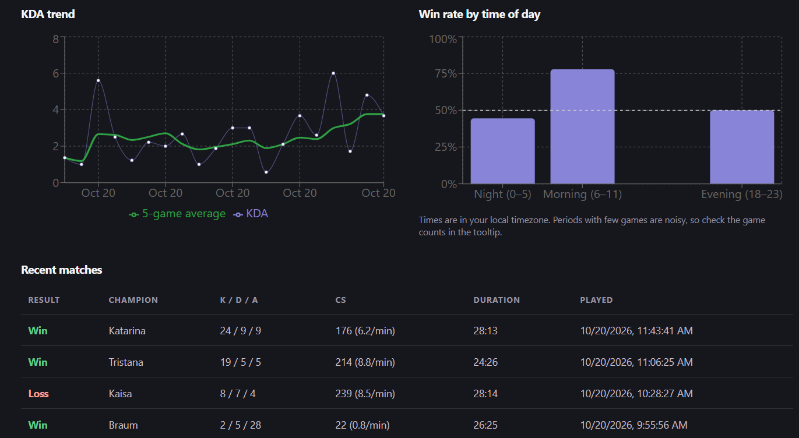
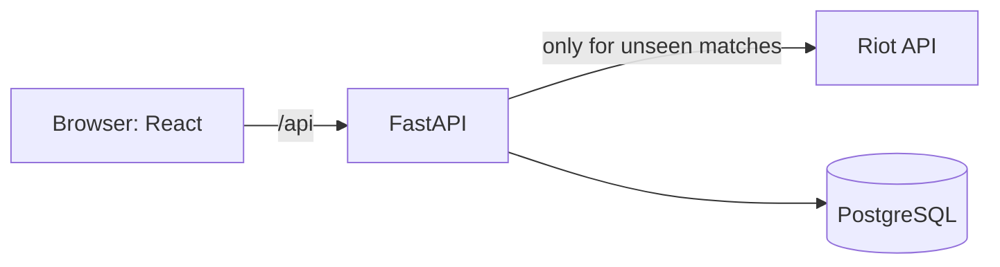

# LoL Match Analyzer

Search a League of Legends player and see their recent ranked games as stats and
charts: win rate, KDA trend, CS/min, most-played champions, and win rate by time of day.

[](https://github.com/hoshimiyo/lol_analyzer/actions/workflows/ci.yml)



## Features
- Fetches matches from the Riot API and stores them, so repeat searches only
  request games it hasn't seen
- Stats computed with pandas: overall KDA, CS/min, per-champion breakdown,
  5-game rolling KDA, win rate by time of day in the user's timezone
- Filter by champion and date range
- Rate-limit handling: bounded concurrency and `Retry-After` backoff on 429s

## Architecture

One Docker image: FastAPI serves the API and the built React app.

## Stack
- **Backend:** Python, FastAPI, httpx, SQLAlchemy (async), pandas, Pydantic
- **Frontend:** React, Vite, TanStack Query, Recharts
- **Infra:** Docker (multi-stage), Render, PostgreSQL
- **Tests:** pytest with a fake Riot client and in-memory SQLite

### Design decisions

- **Async end to end.** FastAPI, httpx and SQLAlchemy 2 async mean the app can fetch several Riot match summaries concurrently instead of one at a time.
- **Skip known matches.** Match IDs are diffed against the database before any detail request is made, so repeat searches cost one list call instead of N detail calls. This protects the Riot rate limit.
- **Rate-limit handling.** A class-level `asyncio.Semaphore(5)` caps concurrent Riot requests, and 429 responses are retried up to 3 times using the `Retry-After` header.
- **Pure `compute_stats` function.** Stats logic takes plain data and returns plain data, with no I/O. That makes it easy to unit test with hand-computed expectations.
- **Filtering in SQL.** Champion and date filters run in the database query, and the frontend mirrors the same rules for the match table.
- **API key stays server-side.** The browser never sees the Riot key.
- **Dev/prod split.** SQLite locally, Postgres in production, switched by `DATABASE_URL`. One production-only bug (epoch-ms timestamps overflowing a 32-bit integer) is why `game_start` is a `BigInteger`.

## Run locally
```bash
# backend
cd backend
python -m venv .venv && source .venv/bin/activate
pip install -r requirements-dev.txt
echo "RIOT_API_KEY=RGAPI-your-key" > .env
uvicorn app.main:app --reload

# frontend (another terminal)
cd frontend && npm install && npm run dev
```
Open http://localhost:5173

## Tests
```bash
cd backend && pytest -v
```

## Design decisions
- **Matches are immutable, so the DB is a cache.** A repeat search costs 2 Riot
  calls instead of ~12.
- **Filters run in SQL, aggregation in pandas,** so the database discards rows
  before they reach Python.
- **Pure `compute_stats` function** with no FastAPI or DB dependency, so it is
  tested against hand-computed numbers.
- **Timestamps as epoch milliseconds** end to end, to avoid timezone ambiguity.

## Known limitations / next steps
- Schema is created with `create_all`; Alembic migrations would be the next step
- Concurrent duplicate requests can hit the unique constraint (needs `ON CONFLICT DO NOTHING`)
- No per-IP rate limiting on the public endpoint